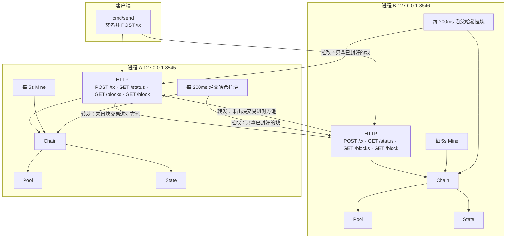
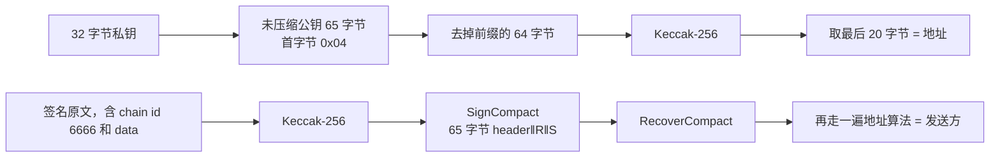
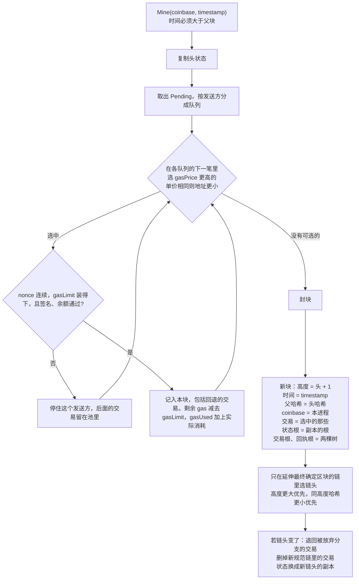
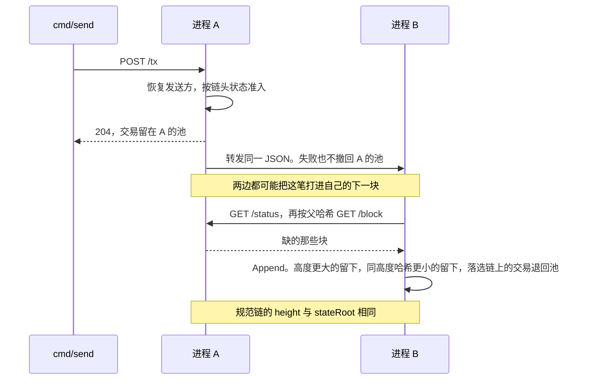
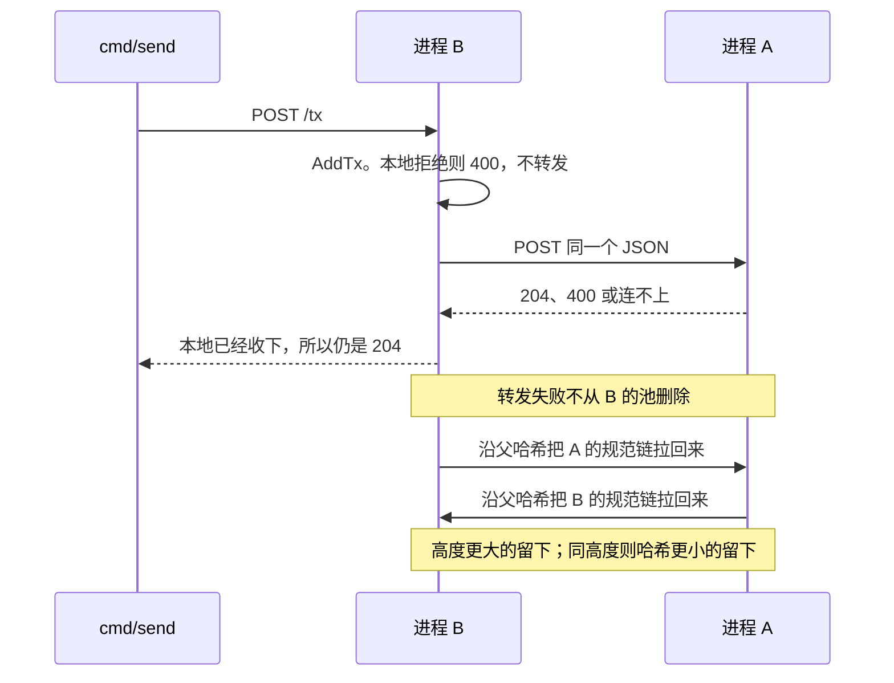

# minichain 学习指南

minichain 是一条只存在内存里的链。账户可以只存余额，也可以带上代码和存储。每个进程都出块，也向对等方拉块。同一父块上可以分叉；节点按「高度更大，同高度则哈希更小」选出链头，换链头时把被放弃的交易退回交易池。链头往前 12 块已经最终确定，从更早的高度分出去的叉不能再成为链头。两边对规范链算出同一个状态根。它用来建立「账户、签名、chain id、gas、交易池、执行、回执、出块、分叉、同步」这条链路。执行是一台很小的虚拟机：没有代码的收款方仍是转账，有代码就按操作码执行。没有 data 的转账起步 gas 是 21000。

建议按下面的顺序读，每一层都先看测试再看实现。

| 顺序 | 文件 | 要回答的问题 |
| --- | --- | --- |
| 1 | `README.md`、`docs/superpowers/specs/2026-10-30-forks-design.md` | 两个进程怎样出块、分叉和回滚 |
| 2 | `chain/tx.go`、`chain/block.go`、`chain/address.go`、`chain/receipt.go`、`chain/trie.go`、`chain/rlp.go` | 交易、回执和三棵树的根从哪来 |
| 3 | `sig/sig.go` | 地址和发送方怎么从私钥推出来 |
| 4 | `chain/state.go` | 状态根为什么和插入顺序无关 |
| 5 | `chain/pool.go` | 什么交易能进池，同 nonce 何时被更高单价替换 |
| 6 | `chain/apply.go`、`chain/vm.go` | 一笔交易怎样转账、跑字节码、收费，失败时为什么还入块 |
| 7 | `chain/chain.go`、`chain/fork_test.go` | `Mine` 怎么挑交易，链头怎么选，回滚怎样退回交易 |
| 8 | `node/http.go`、`node/node.go`、`cmd/node/main.go`、`cmd/send/main.go` | 交易怎样转给对等方，分叉怎样沿父哈希拉回来 |
| 9 | `view/`、`cmd/view/main.go` | 只读页面怎样把查询转到节点，它为什么不导入 `chain` |

测试直接调用 `Mine`、`Apply`、`FollowOnce`，不靠 `time.Sleep`。时间只出现在 `cmd/node` 的两个循环里。

## 架构

`cmd` 里有三个命令。`cmd/node` 和 `cmd/send` 用 `chain`，`cmd/node` 还用 `node`。`node` 用 `chain`，`chain` 用 `sig`。`view` 不导入 `chain`，只校验节点地址并转发 GET。地址可以是 `主机:端口`，也可以写成 `http://主机:端口`。



图里有两条互不替代的线。转发发生在本地准入成功之后：把还在池里、尚未出块的同一份交易 JSON 推给对端，两边的下一轮 `Mine` 才都可能选中它。`Follow` 每 200ms 只读对方链头；哈希本地已有就结束，否则按父哈希拉已经封好的块。交易没进块之前，拉取看不到它。准入失败直接 `400`，不转发。准入成功则本机已收下，转发失败也不从本机池删除，对端以后仍能从出块后的拉取里对齐。

A 和 B 各自 `chain.New()`，内存里都有同一份创世块：高度 0，父哈希 32 个 0，coinbase 是 20 个 0，只有演示账户。创世块两边都有，不需要从对等方拉。两个进程的 `--coinbase` 不同，空块的哈希才会不同。

演示账户写在 `sig.DemoKeyHex`：

- 私钥 `ac0974bec39a17e36ba4a6b4d238ff944bacb478cbed5efcae784d7bf4f2ff80`（Hardhat / Anvil 的第 0 个账户）
- 地址 `0xf39fd6e51aad88f6f4ce6ab8827279cfffb92266`
- 创世余额 `1000000000000000000`（`chain.Unit`，1 个币）。1 个币等于 10^18 个最小单位。nonce `0`

`Chain` 用一把 `sync.Mutex` 罩住区块、状态和交易池。HTTP 和出块循环都通过 `AddTx`、`Mine`、`Append` 进出。

需要这一把锁，是因为同一个进程里有几件事同时在跑。出块循环在自己的 goroutine 里调用 `Mine`。HTTP 服务同时接受 `POST /tx`，并回答链头和区块查询。配置了 `--peers` 时，主循环还在 `FollowOnce` 里 `Append` 对方的块。这三件事改的是同一条链。

Go 的 map 不允许一边读一边写，并发写会直接崩溃。交易池是一块切片，出块在读它的时候，收交易又在往后面追加，切片本身也会坏掉。

链头、状态和池还必须一起变。`AddTx` 要按当前链头上的余额和 nonce 决定收不收。`Mine` 从池里拿走交易、写出新块，再把链头指过去。`Append` 接上别人的块之后可能换链头，还要把新分叉里已经入块的交易从池里丢掉，把旧分叉里没花掉的交易放回去。这三份数据要是各用一把锁，可能出现链头已经换了、池里还留着按旧链头收进来的交易，或者块已经接上、对应的交易还在池里等着再出一次。一把锁把「看链头、改池、换状态」收成一次做完，做完才放开。

## 数据怎么变成哈希

整数都是大端。JSON 里的十六进制是小写，可以带 `0x`。

```text
签名原文。调用时先放 20 字节 to，创建合约时没有这 20 字节。后面再接 data。
没有 data 时，调用是 64 字节，创建是 44 字节。

调用
┌────────┬─────────┬─────────┬──────────┬──────────┬──────────┬──────────┐
│ to  20 │ value 8 │ nonce 8 │ gasLimit 8 │ gasPrice 8 │ chainId 8 │ dataLen 4 │
└────────┴─────────┴─────────┴──────────┴──────────┴──────────┴──────────┘
创建
┌─────────┬─────────┬──────────┬──────────┬──────────┬──────────┐
│ value 8 │ nonce 8 │ gasLimit 8 │ gasPrice 8 │ chainId 8 │ dataLen 4 │
└─────────┴─────────┴──────────┴──────────┴──────────┴──────────┘
to 不出现才是创建。to 是 20 个 0 是转给零地址，不是创建。data 可以是空的：创建时它是初始代码，调用时它是调用数据。

规范交易 = 签名原文 + 65 字节签名。没有 data 的调用共 129 字节。

区块哈希原文
┌────────────┬────────────┬────────────────────┬──────────────┬──────────────┬────────────┬──────────┬──────────┬────────┐
│ parent  32 │ state   32 │ transactions    32 │ receipts  32 │ coinbase  20 │ gasLimit 8 │ gasUsed 8│ height 8 │ time 8 │
└────────────┴────────────┴────────────────────┴──────────────┴──────────────┴────────────┴──────────┴──────────┴────────┘
```

状态根、交易根、回执根都是十六叉 Merkle Patricia Trie。节点用 RLP 编码。小于 32 字节的节点嵌进父节点，否则放 Keccak-256。根再哈希一次。空树的根是 Keccak-256(0x80)，`56e81f171bcc55a6ff8345e692c0f86e5b48e01b996cadc001622fb5e363b421`。

状态树的键是地址的 Keccak-256，值是 `nonce`、余额、`storageRoot`、`codeHash` 的 RLP 列表。没有代码时 `codeHash` 是空字节的 Keccak-256。没有存储时 `storageRoot` 是空树根。交易树和回执树的键是序号的 RLP。交易树的值是规范交易。回执树的值是 status、gasUsed、cumulativeGasUsed 和日志的 RLP 列表。交易原文留在区块体里，不直接拼进区块哈希。

创世状态里有演示账户，所以创世状态根不是空树根。创世块没有交易和回执，那两个根是空树根。

`Put` 插入或覆盖，`Delete` 删除。余额变成 0 不会自动删账户。同一批账户无论以什么顺序放入，根都相同。

## 签名和地址
- sig/sig.go: Recover 函数
- sig/sig.go: KeyAddress 函数



交易里不写发送方。`Tx.Sender` 对签名原文做 Keccak-256，再用 `ecdsa.RecoverCompact` 恢复公钥，然后取地址。`SignCompact` 的第三个参数是 `false`，恢复标记是 27 或 28。签名长度不是 65，或恢复失败，都是 `ErrBadSignature`。

`chain.ChainID` 是 `6666`，写在 `data` 长度之前的 8 字节。改掉已签名交易里的 chain id、gasLimit、gasPrice 或 data 之后，恢复出来的地址不再是原签名者。用别的 chain id 签出来的交易仍能恢复出发送方，但 `Pool.Add` 和 `Apply` 返回 `wrong chain id`。`cmd/send` 没有 chain id 开关，固定传 `chain.ChainID`。`--to` 留空是创建合约，`--data` 是调用数据或初始代码。

## 交易池和执行是两套规则

进池看的是「现在的账户」。执行看的是「按顺序应用到当前 nonce」。

| | 交易池 `Pool.Add` | 执行 `Apply` |
| --- | --- | --- |
| 签名 | 恢复失败 → `bad signature` | 同样 |
| chain id | 不是 `6666` → `wrong chain id` | 同样，而且排在余额检查之前 |
| gas | `gasLimit` 小于起步 gas → `intrinsic gas`。转账从 21000 起，创建从 53000 起，data 里零字节加 4，非零字节加 16 | 同样。实际消耗按执行计算，不是按 `gasLimit` 收。gas 用尽时消耗整个 `gasLimit` |
| 费用预留 | 这一笔，加上同一发送方已经在池里的其他交易，`value + gasLimit * gasPrice` 之和大于余额 → `insufficient balance` | 实际从发送方扣除 `value + gasUsed * gasPrice`。回退时 value 会退回，费用仍扣 |
| nonce | 小于账户当前值 → `nonce too low`。大于当前值可以进池。同一发送方、同一 nonce 已在池中时，只有 `gasPrice` 严格更高才替换，否则 `replacement underpriced` | 必须等于当前 nonce，否则 `nonce mismatch` |
| 溢出 | `gasLimit * gasPrice` 或再加上 `value` 超出 `uint64` → `balance overflow` | 收款方或 coinbase 入账溢出同样是 `balance overflow`，状态不动 |
| 成功后 | 放进池，或替换同 nonce 的旧交易 | 签名和余额通过后就会入块。执行成功时状态是 1，nonce 加 1，代码和存储留下。回退或 gas 用尽时状态是 0，nonce 仍加 1，这次改过的状态丢掉。coinbase 得到 `gasUsed * gasPrice` |

账户不存在时，池和执行都把余额、nonce 当成 0。发给自己时，`value` 不改变余额，费用仍然付给 coinbase，nonce 仍加 1。发送方就是 coinbase 时，费用先从自己扣下再加回。

`Apply` 先复制状态。签名、chain id、gas 或余额不过关时，原状态不动，这笔交易不能入块。执行回退时换回副本，只保留 nonce 和 gas 费用。

`Pending` 的顺序是发送方地址升序，同一发送方再按 nonce 升序。出块不按这个顺序装，装块时在各账户的下一笔里选 gas 单价。

## 合约和回执

`to` 不出现是创建合约。`to` 写成 20 个 0 是转给零地址。合约地址是 `Keccak-256(RLP(发送方, 创建前的 nonce))` 的后 20 字节。新合约的 nonce 先写成 1，再跑初始代码。`RETURN` 出来的字节才存成合约代码，每字节再收 200 gas，代码最长 24576 字节。调用已有代码时，`data` 是调用数据。

操作码有压栈、加减、读写存储、复制代码、读调用数据、跳转、`CALL`、`RETURN`、`REVERT`、`LOG0` 和 `LOG1`。加减在 2^256 上取模。每个操作码单独扣 gas。`CALL` 最多把本帧剩余 gas 的 63/64 转给内层，金额必须放进 `uint64`。内层失败只回退那一层，外层还可以成功。`JUMP` 的目标必须是 `JUMPDEST`，而且不能落在 `PUSH` 的立即数里。

状态树里的账户是 `nonce`、余额、`storageRoot`、`codeHash`。每个合约另有一棵存储树，键是 32 字节槽位的 Keccak-256，值为零的槽会被删掉。

回执记下状态、本笔 gas、累计 gas 和日志。执行成功时状态是 1，日志留下。`REVERT` 或 gas 用尽时状态是 0，日志丢掉，nonce 和费用留下，余额、代码和存储回到执行前。签名错误、chain id 不对、gas 不够起步、nonce 不对、余额不够，这些交易不入块，状态也不动。日志写进回执树，所以回执根会随日志变化。区块头里没有 logsBloom。

## 出块

每个进程都调用 `Mine(coinbase, timestamp)`，只延长自己的规范链头。`timestamp` 必须大于父块时间。`cmd/node` 用当前 Unix 秒；时钟没有走过父块时间时，改用父块时间加 1。池空时仍然出一个空块，状态根不变，交易根和回执根都是空树根。启动后先 `Mine` 一次，再按 `--interval`（默认 5 秒）循环，所以进程启动后很快就有高度 1。coinbase 写进区块哈希，两个进程的 coinbase 不同，空块才分得开。每个块的 `gasLimit` 都是 `100000`。高度和时间也写进区块哈希。



同一账户仍按 nonce 从当前值连续装。不同账户之间，比较的是各自下一笔的 `gasPrice`，更高的先装；单价一样时地址更小的先装。碰到缺口、这笔的 `gasLimit` 大于区块剩余 gas，或者这笔交易签名和余额不过关，就停在这个发送方。回退的交易仍然入块，后面的 nonce 可以继续装。装块时按 `gasLimit` 占区块 gas，记账时 `gasUsed` 加的是实际消耗。

池会把同一发送方的待处理交易加在一起占余额。`gasLimit` 为 `21000`、`gasPrice` 为 `1` 时，一笔要预留 `value + 21000`。下面用余额 `1000000` 说明预留，这不是创世余额；创世账户有 1 个币，放得下这些数。余额 `1000000` 时，nonce 0 转 `979000` 可以进池，预留刚好是 `1000000`。nonce 1 再转 `979000` 会被拒绝，两笔合起来是 `2000000`。每笔只转 `1` 时，两笔都能进池。出块先执行 nonce 0。coinbase 不是发送方时，发送方余额变成 0；发送方自己就是 coinbase 时，费用会加回，余额剩下 `21000`。两种情况下，如果 nonce 1 预留超过当时的余额，它就进不了池。

## 跟块

进程启动时把监听地址、coinbase、出块间隔、chain id 和 peer 打到标准错误。有 `--peers` 时，每个进程每 `--poll`（默认 200ms）读对等方的 `GET /status`。本地已经有那个链头哈希就结束这一轮。否则 `GET /block?hash=` 从链头往父块取，直到父块本地已经有，再从最老的一块开始 `Append`。对等方连不上时打印一次 `sync:`，之后同样的失败不再重复打印，进程继续出块。第一次连上，以及中断后再次连上，打印 `sync: connected` 和对方地址。已经连着的轮询不再重复打印。一边退出后，另一边不退出。

`Append` 保存任何父块已经在本地的块：

1. `decodeBlock` 用同一套字节规则重算哈希，必须等于 JSON 里的 `hash`
2. 同一哈希再来一次：什么都不改，返回 nil
3. 父块必须已经保存。高度必须是父块高度加 1。时间必须大于父块时间
4. `gasLimit` 必须是 `100000`。交易的 `gasLimit` 加起来也不能超过它
5. 用区块体里的交易重算交易根，必须等于块上的 `transactionsRoot`
6. 在父块状态的副本上按顺序 `Apply`。实际消耗之和必须等于块上的 `gasUsed`。状态根必须等于块里的 `stateRoot`，回执根必须等于块里的 `receiptsRoot`

通过后保存块和状态副本，再选链头。链头往前数 12 块（高度不到 12 时就是创世块）是最终确定的。不包含这个块的分叉仍会保存，但选链头时跳过它。新链头上的交易从池里删除。旧链头上、且新链没有花掉同一发送方和 nonce 的交易，按新状态重新进池。侧链上的块留在内存里，`BlocksAfter` 只列出规范链。

A 和 B 同时出块时，链头会短暂不同。两边把对方缺的块拉齐之后，手里是同一批区块，用同一条规则选链头，所以不会来回翻。状态整份换成赢的那条链头执行完的快照，不会把两套余额拼在一起。分叉点已经落在最终确定区块之前时，对方更长的链会存下来，但不会成为链头，两边就各自留下。

## 时序：交易发给 A



## 时序：交易发给 B

B 用本机状态做准入，所以发之前要先等两边 `GET /status` 的 `height` 和 `stateRoot` 一致。



出块和同步之间有一个窗口：一边的池已经没有这笔，另一边的池还有，两边状态根也不相同。分叉还没越过最终确定区块时，再过一轮拉取，两边会选中同一条链头。已经越过 12 块的分叉不会被这次拉取换掉。

## HTTP

| 方法 | 路径 | 谁提供 | 作用 |
| --- | --- | --- | --- |
| `POST` | `/tx` | 每个进程 | 本机准入失败返回 `400`。本机成功返回 `204`，并尽力转发给每个对等方 |
| `GET` | `/status` | 每个进程 | 本机规范链头：`height`、`stateRoot`、`head` |
| `GET` | `/blocks?after=<height>` | 每个进程 | 规范链上高度大于 `after` 的块。不含创世块，也不含侧链 |
| `GET` | `/block?hash=<hex>` | 每个进程 | 按哈希取一块。没有则 `404` |
| `GET` | `/account?address=<hex>` | 每个进程 | 链头上这个地址的 `balance` 和 `nonce`，以及下一笔可用的 `nextNonce`。地址不存在时余额和 nonce 都是 0。地址不合法返回 `400` |

`cmd/send` 不写 `--nonce` 时，向 `--url` 的 `GET /account` 读取 `nextNonce`。这个数是链上 nonce，再跳过该进程交易池里已经占住的号码；有缺口时先填缺口。写了 `--nonce` 就用给定的数。`--key` 省略时用演示私钥。`--value` 按最小单位填写，`10^18` 是 1 个币。`--to` 留空是创建合约，`--data` 是调用数据或初始代码。`--gas-limit` 默认 `21000`，`--gas-price` 默认 `1`。chain id 固定为 `6666`。

没写 `--listen` 时，单独一个进程听 `127.0.0.1:8545`。命令行里写了 `--peers` 且没写 `--listen` 时，改听 `127.0.0.1:8546`，方便本机再开第二个进程。两个进程都写了 `--peers` 又都省略 `--listen` 时，会抢同一个 `8546`。

`cmd/view` 默认听 `127.0.0.1:8080`，启动时把这个地址打到标准错误。页面填写 `主机:端口`，也可以写 `http://主机:端口`。查看进程把 `GET /api/status`、`GET /api/blocks` 和 `GET /api/account` 转到该节点的 `/status`、`/blocks` 和 `/account`。余额订阅每 3 秒查一次，显示余额和 nonce。页首可以暂停这两路刷新；继续时丢掉暂停前的数据，再按当前链重拉。它只接受 GET，不跟随重定向。

```bash
go test ./...

# 终端 1
go run ./cmd/node --listen 127.0.0.1:8545 --peers http://127.0.0.1:8546 --coinbase 0xf39fd6e51aad88f6f4ce6ab8827279cfffb92266

# 终端 2
go run ./cmd/node --listen 127.0.0.1:8546 --peers http://127.0.0.1:8545 --coinbase 0x0000000000000000000000000000000000000002

curl -s http://127.0.0.1:8545/status
curl -s http://127.0.0.1:8546/status

go run ./cmd/send \
  --url http://127.0.0.1:8545 \
  --to 0x0000000000000000000000000000000000000001 \
  --value 10 \
  --nonce 0
```

## 和以太坊概念的对应

读 go-ethereum 时可以这样对上：

- 余额和转账金额按最小单位记。1 个币是 `10^18`，创世账户有 1 个币。类型是 `uint64`，一个账户最多大约 18 个币。
- `Account.Nonce` 就是以太坊账户 nonce：交易入块就加 1，回退也加，用来挡住重放。
- 交易池是一个简化的 txpool。这里允许未来 nonce 进池，出块要求从当前 nonce 连续执行。同一 nonce 只有 gas 单价严格更高才替换。
- 没有 data 的转账起步 gas 是 `21000`。创建合约从 `53000` 起，data 按字节加价，代码按每字节 `200` 收取。费用进区块的 coinbase。区块 gas 上限是 `100000`。操作码只有压栈、加减、存储、调用、返回、回退和日志这一小部分。没有 EIP-1559。
- `State.Root`、`TransactionsRoot`、`ReceiptsRoot` 都是 Merkle Patricia Trie 的根。状态树的键是地址哈希，值包含存储根和代码哈希。每个合约另有一棵存储树。交易树和回执树的键是序号的 RLP。
- `Block.Hash` 把父哈希、三个树根、coinbase、gas、高度和时间绑在一起。改其中任何一项，哈希都变，子块的父哈希就对不上。交易原文在区块体里。
- 多个进程出块对应短程分叉。这里用块数做链头选择，同高度比哈希。链头往前 12 块之后不能再被换掉，这是一个很短的最终性，不是信标链投票。没有节点发现，也没有落盘。链只在进程内存里，退出即丢失。
- 换链头时退回被放弃分支的交易，对应节点重组时把孤儿块里的交易放回交易池。
- 签名恢复发送方，和以太坊从签名恢复 `from` 是同一件事。chain id `6666` 写在 `data` 长度之前。恢复标记仍是 27 或 28，没有把 chain id 编进 `v`。
- 合约地址是 `Keccak-256(RLP(sender, nonce))` 的后 20 字节，nonce 用创建前的值。初始代码 `RETURN` 出来的字节才是合约代码。成功的日志留在回执里，回退的日志丢掉。

没有节点发现，也没有数据库。同步和出块的外壳可以保持不动。
