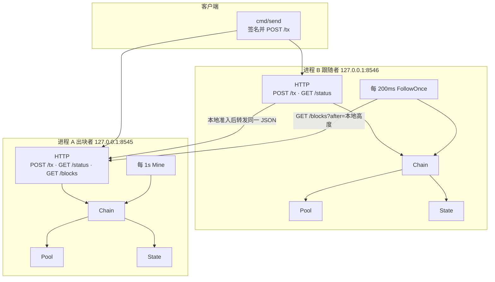
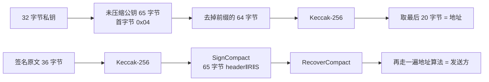
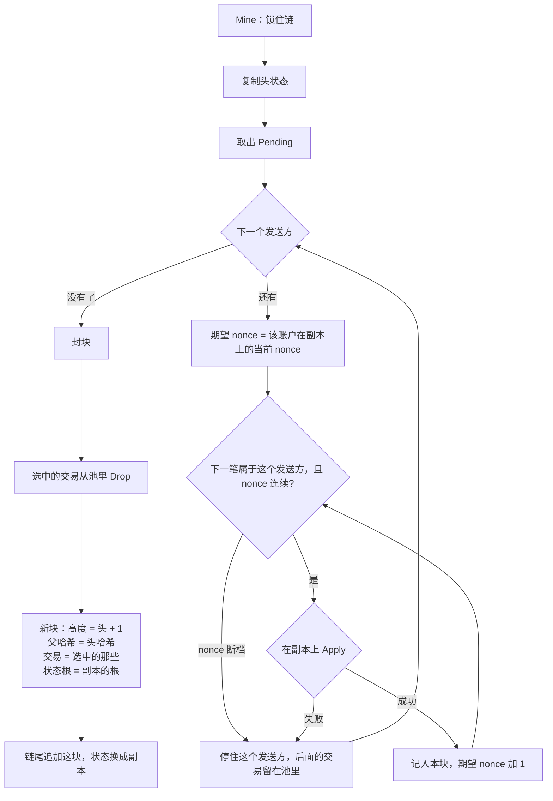
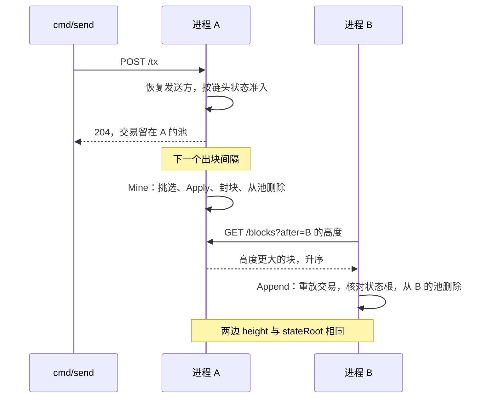
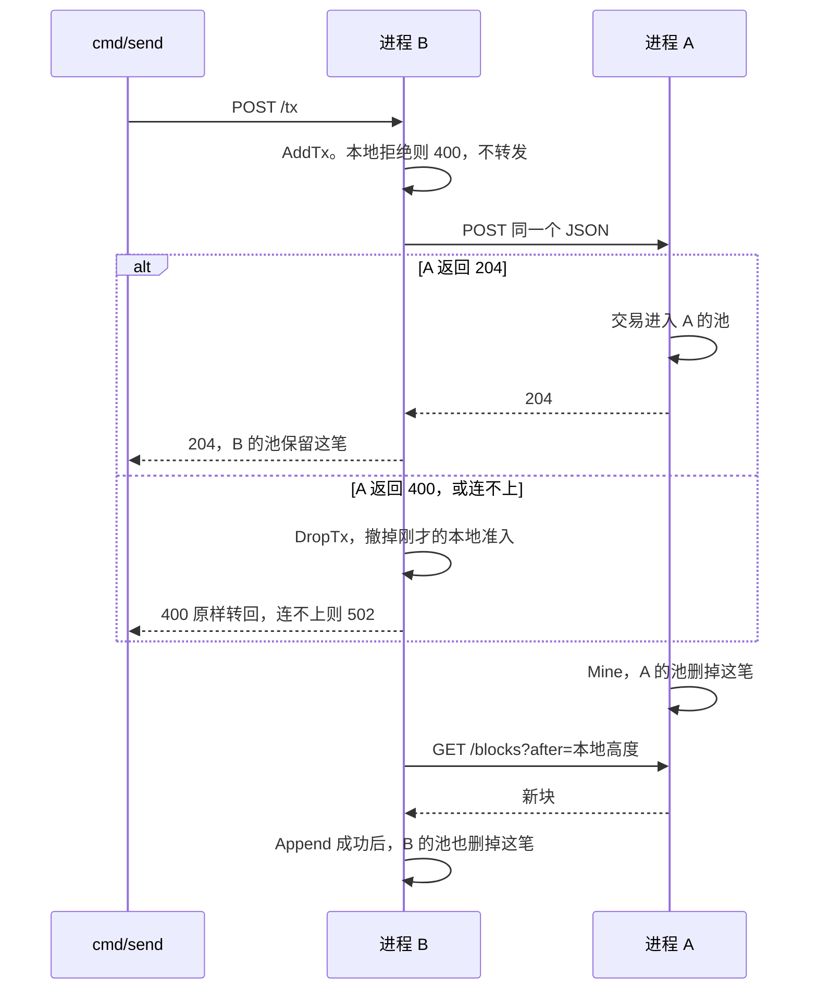

# minichain 学习指南

minichain 是一条只存在内存里的转账链：进程 A 出块，进程 B 跟块。两边对同一批已签名转账算出同一个状态根。它用来建立「账户、签名、交易池、执行、出块、同步」这条链路，范围停在转账。

建议按下面的顺序读，每一层都先看测试再看实现。

| 顺序 | 文件 | 要回答的问题 |
| --- | --- | --- |
| 1 | `README.md`、`docs/superpowers/specs/2026-10-29-minichain-design.md` | 两个进程各自做什么 |
| 2 | `chain/tx.go`、`chain/block.go`、`chain/address.go` | 交易和区块的字节从哪来 |
| 3 | `sig/sig.go` | 地址和发送方怎么从私钥推出来 |
| 4 | `chain/state.go` | 状态根为什么和插入顺序无关 |
| 5 | `chain/pool.go` | 什么交易能进池 |
| 6 | `chain/apply.go` | 一笔转账怎样改余额和 nonce |
| 7 | `chain/chain.go` | `Mine` 怎么挑交易，`Append` 怎么拒块 |
| 8 | `node/http.go`、`node/node.go`、`cmd/node/main.go`、`cmd/send/main.go` | 交易怎么从 B 汇合到 A，块怎么拉回来 |

测试是表驱动的，直接调用 `Mine`、`Apply`、`FollowOnce`，不靠 `time.Sleep`。时间只出现在 `cmd/node` 的两个循环里。

## 架构

四个包，依赖方向是单向的：`cmd` 用 `node` 和 `chain`，`node` 用 `chain`，`chain` 用 `sig`。



A 和 B 各自 `chain.New()`，内存里都有同一份创世块：高度 0，父哈希 32 个 0，只有演示账户。B 不向 A 拉创世块。

演示账户写在 `sig.DemoKeyHex`：

- 私钥 `ac0974bec39a17e36ba4a6b4d238ff944bacb478cbed5efcae784d7bf4f2ff80`（Hardhat / Anvil 的第 0 个账户）
- 地址 `0xf39fd6e51aad88f6f4ce6ab8827279cfffb92266`
- 创世余额 `1000000`，nonce `0`

`Chain` 用一把 `sync.Mutex` 罩住区块、状态和交易池。HTTP 和出块循环都通过 `AddTx`、`Mine`、`Append` 进出。

## 数据怎么变成哈希

整数都是大端。JSON 里的十六进制是小写，可以带 `0x`。

```text
签名原文 36 字节
┌────────────┬──────────┬──────────┐
│ to      20 │ value  8 │ nonce  8 │
└────────────┴──────────┴──────────┘

规范交易 101 字节 = 签名原文 + 签名
┌──────────────┬─────────┐
│ signing  36  │ sig  65 │
└──────────────┴─────────┘

区块哈希原文
┌────────────┬────────────┬────────────┬──────────────────┐
│ parent  32 │ root    32 │ txCount  4 │ 每笔交易 101 字节 │
└────────────┴────────────┴────────────┴──────────────────┘

状态根：账户按地址字节升序，每个账户 36 字节再拼接，对整段做 Keccak-256
┌────────────┬───────────┬──────────┐
│ address 20 │ balance 8 │ nonce  8 │
└────────────┴───────────┴──────────┘
```

空账户列表的根是 Keccak-256(空字节)，`c5d2460186f7233c927e7db2dcc703c0e500b653ca82273b7bfad8045d85a470`。这和以太坊里空字节串的 Keccak 是同一个常数。创世状态里有演示账户，所以创世状态根不是这个空根。

`Put` 插入或覆盖，`Delete` 删除。余额变成 0 不会自动删账户。同一批账户无论以什么顺序放入，根都相同，因为 `Root` 会先排序。

## 签名和地址



交易里不写发送方。`Tx.Sender` 对签名原文做 Keccak-256，再用 `ecdsa.RecoverCompact` 恢复公钥，然后取地址。`header` 是 27 或 28。签名长度不是 65，或恢复失败，都是 `ErrBadSignature`。

## 交易池和执行是两套规则

进池看的是「现在的账户」。执行看的是「按顺序应用到当前 nonce」。

| | 交易池 `Pool.Add` | 执行 `Apply` |
| --- | --- | --- |
| 签名 | 恢复失败 → `ErrBadSignature` | 同样 |
| nonce | 小于当前值 → `ErrNonceTooLow`；和池里同一发送方的某一笔相同 → `ErrNonceUsed`；大于当前值可以进池 | 必须等于当前 nonce，否则 `ErrNonceMismatch` |
| 余额 | `value` 大于账户当前余额 → `ErrInsufficientBalance`。不扣掉池里其他待处理交易 | `value` 大于发送方余额则失败 |
| 溢出 | 不检查 | 收款方余额加 `value` 超过 `uint64` → `ErrBalanceOverflow`，状态不动 |
| 成功后 | 原样放进池 | 发送方 nonce 加 1，余额减去金额；收款方不存在就建一个 nonce 为 0 的账户 |

账户不存在时，池和执行都把余额、nonce 当成 0。发送方和收款方是同一地址时，余额不变，nonce 仍加 1。

`Apply` 改的是调用方传入的状态。`Mine` 和 `Append` 都先 `Copy`，失败就丢掉副本。

`Pending` 的顺序是发送方地址升序，同一发送方再按 nonce 升序。这个顺序就是出块时的挑选顺序。

## 出块

只有 A 调用 `Mine`。池空时仍然出一个空块，状态根不变。`cmd/node` 在没有 `--peer` 时先 `Mine` 一次，再按 `--interval`（默认 1 秒）循环，所以进程启动后很快就有高度 1。



挑选是按发送方一段一段看的。从该账户当前 nonce 起必须连续。碰到缺口，或者这笔 `Apply` 会失败，就停在这个发送方。更高的 nonce 留在池里，等以后某一块能接上。

这里有一个要亲自验证的行为：池的余额检查只和账户里已有的余额比。余额 `1000000` 时，nonce 0 和 nonce 1 可以各转 `1000000` 都进池。出块时 nonce 0 成功，nonce 1 在副本上余额不够，于是留在池里。下一块它还会失败，直到有一笔入账把余额补上。

## 跟块

B 每 `--poll`（默认 200ms）请求 `GET /blocks?after=<本地高度>`，按返回顺序 `Append`。空列表是正常结果，继续轮询。请求失败、状态码不是 200、JSON 解析失败、或 `Append` 拒绝，都打印 `sync:` 并以状态码 1 退出。A 被 Ctrl-C 关掉后，B 下一次拉块就会这样退出。

`Append` 同时满足下面几条才接块，否则链和状态都不变：

1. `decodeBlock` 用同一套字节规则重算哈希，必须等于 JSON 里的 `hash`
2. 父哈希等于本机链头的哈希
3. 高度等于链头高度加 1
4. 在状态副本上按顺序 `Apply`，算出的根等于块里的 `stateRoot`

成功后才把块挂上，并把块里每笔交易从本机池删掉。用户只把交易发给 A 时，B 的池里可以没有它；`Drop` 找不到就跳过，状态仍然追平。

## 时序：交易发给 A



## 时序：交易发给 B

B 用本机状态做准入，所以发之前要先等两边 `GET /status` 的 `height` 和 `stateRoot` 一致。



A 出块和 B 拉块之间有一个窗口：A 的池已经没有这笔，B 的池还有，两边状态根也不相同。再过最多一个轮询间隔，B 追上。

## HTTP

| 方法 | 路径 | 谁提供 | 作用 |
| --- | --- | --- | --- |
| `POST` | `/tx` | A 和 B | 提交已签名交易。成功 `204`，拒绝 `400`，正文是错误文本 |
| `GET` | `/status` | A 和 B | 本机链头：`height`、`stateRoot`、`head` |
| `GET` | `/blocks?after=<height>` | 只有 A | 高度大于 `after` 的块。缺省 `after=0`，所以不含创世块 |

`cmd/send` 的 `--nonce` 必填，它不向节点查当前 nonce。`--key` 省略时用演示私钥。

```bash
go test ./...

# 终端 1
go run ./cmd/node

# 终端 2
go run ./cmd/node --peer http://127.0.0.1:8545

curl -s http://127.0.0.1:8545/status
curl -s http://127.0.0.1:8546/status

go run ./cmd/send \
  --url http://127.0.0.1:8545 \
  --to 0x0000000000000000000000000000000000000001 \
  --value 10 \
  --nonce 0
```

## 和以太坊概念的对应

读 go-ethereum 时可以这样对上：

- `Account.Nonce` 就是以太坊账户 nonce：每成功执行一笔，加 1，用来挡住重放。
- 交易池是一个简化的 txpool。这里允许未来 nonce 进池，但出块要求从当前 nonce 连续执行。
- `State.Root` 对应状态根的角色，算法是「排序后拼接再哈希」。以太坊用的是 Merkle Patricia Trie。
- `Block.Hash` 把父哈希、状态根、交易绑在一起。改其中任何一项，哈希都变，子块的父哈希就对不上。
- A/B 对应「一个出块者 + 一个同步者」。没有节点发现、没有分叉选择、没有持久化。链只在进程内存里，退出即丢失。
- 签名恢复发送方，和以太坊从 `v,r,s` 恢复 `from` 是同一件事。这里签的是 36 字节转账原文，用的是 `header || R || S`，没有 EIP-155 的 chain id。

这个仓库停在转账。EVM、合约、gas、点对点发现、数据库都不在代码里。下一步如果要往执行引擎走，就从 `Apply` 换成「按交易字节跑虚拟机，再用执行后的状态算根」。同步和出块的外壳可以保持不动。
